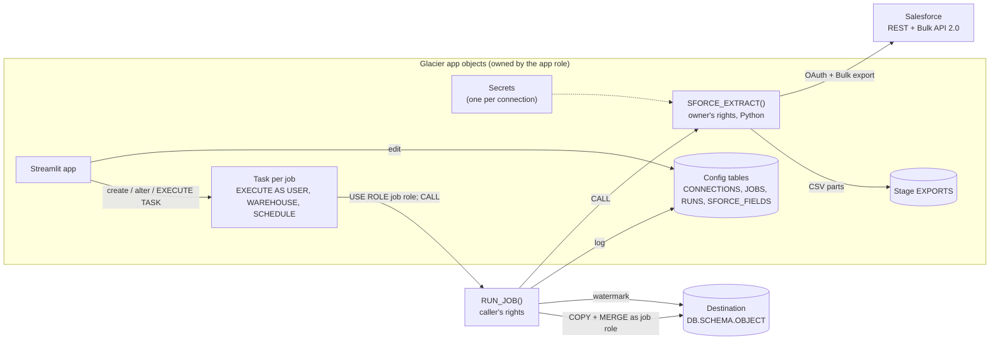

# Glacier as a Streamlit in Snowflake app

Status: phases 1 and 2 are built (engine and app); see [Phases](#phases).

## Goal

Run Glacier entirely inside Snowflake, managed from a Streamlit app, with:

- **Multiple Salesforce connections** (orgs, sandboxes), each with its own credentials.
- **Any Salesforce object** imported into a **destination database, schema, and table chosen per
  job**. The table name defaults to the object's API name, split at case changes with `__c`
  shortened (`GiftTransaction` → `GIFT_TRANSACTION`, `Subscription__c` → `SUBSCRIPTION_C`), and
  can be changed. Columns follow the same convention. Snowflake reserved
  words keep their name and are double-quoted in SQL (`Order` → `"ORDER"`), so queries against
  those tables need the quotes too.
- **Per-job choice of Snowflake user, role, and warehouse** that the load runs as.
- The sync behaviour Glacier has today: SystemModstamp deltas merged on Id, typed columns from the
  Salesforce schema, delete handling (`off` / `flag` / `remove`), and the reconcile safety net.

## What the platform allows (and what that means for the design)

| Fact | Source | Consequence |
| --- | --- | --- |
| A Streamlit app runs with its **owner's** rights, not the viewer's, and can't switch roles | [Owner's rights and Streamlit](https://docs.snowflake.com/en/developer-guide/streamlit/object-management/owners-rights) | The app can't *be* another user. It configures jobs; the jobs run as the chosen identity. |
| A task can run `EXECUTE AS USER <user>`. Its primary role is the task owner's role, and `USE ROLE` can switch it | [Run tasks with user privileges](https://docs.snowflake.com/en/user-guide/tasks-intro) | Each job becomes a task, with its own user, role (via `USE ROLE`), warehouse, and schedule. "Run now" in the app runs `EXECUTE TASK`, so manual runs use the same identity. |
| `EXECUTE AS USER` needs `GRANT IMPERSONATE ON USER` to the task owner role, and the user must hold that role | same | One admin grant per run-as user (see [Admin setup](#admin-setup)). |
| `USE ROLE` works inside a Snowflake Scripting block | Tested in `CMILLER_SF_PLAYGROUND`, 2026-10-29 | A task body can switch to the job's role before loading. |
| Network rules accept a one-level wildcard, e.g. `*.my.salesforce.com` | [CREATE NETWORK RULE](https://docs.snowflake.com/en/sql-reference/sql/create-network-rule) | One network rule covers every production org; `*.sandbox.my.salesforce.com` covers sandboxes. New connections need no network change. |
| An external access integration can allow `ALLOWED_AUTHENTICATION_SECRETS = ALL` | [CREATE EXTERNAL ACCESS INTEGRATION](https://docs.snowflake.com/en/sql-reference/sql/create-external-access-integration) | **Decided:** the integration allows all secrets, so new connections need no admin change. |
| `CREATE SECRET` values are masked in query history | Tested in `CMILLER_SF_PLAYGROUND`, 2026-10-29 (`SECRET_STRING = '☺☺☺☺☺'`) | The app can safely create a connection's secret from a form. |
| Only `ACCOUNTADMIN` or a role with `CREATE INTEGRATION` can create an external access integration. The existing `SALESFORCE_ACCESS_INTEGRATION` belongs to `CRM_DB.NPC_EU_INT_API` and only allows that project's secrets | `DESCRIBE INTEGRATION` | Glacier needs its own integration, created once by an admin. |

## Architecture



The key split: **Salesforce access and Snowflake data access are separate.**

- `SFORCE_EXTRACT` is an owner's-rights Python procedure. Only it can read the secrets and reach
  Salesforce. It takes a connection, object, field list, and watermark, runs the Bulk API 2.0 query,
  and writes the CSV parts to the app's `EXPORTS` stage. It never touches destination tables.
- `RUN_JOB` is a caller's-rights procedure, so it runs as the job's role. It reads the watermark
  from the destination table, calls `SFORCE_EXTRACT`, then does the `ALTER` / `COPY` / `MERGE` /
  reconcile against the destination. This was the original local CLI's `sf_to_snowflake.sh`, ported.
- So a job can only write where its role can write, and job roles never see Salesforce credentials.

### Config tables

| Table | Holds |
| --- | --- |
| `CONNECTIONS` | name, My Domain URL (`https://<domain>.my.salesforce.com`), client id, secret name, API version |
| `JOBS` | connection, object, field list (or "all"), destination database, schema, and table (defaults to the object name), delete mode, history on or off, run-as user, role, warehouse, schedule (cron), enabled |
| `RUNS` | one row per run: job, start and end, mode (delta, full, reconcile), rows exported, rows merged, status, error |
| `SFORCE_FIELDS` | cached `describe` per connection and object; replaced the CLI's `schema/` and drives field pickers and column types |

The CLI's `state/*.last_sync` became `RUNS`, and its `objects.conf` and `project.env` became `JOBS` and `CONNECTIONS`.

### Salesforce authentication

**Decided: JWT bearer for every connection** (switched from client credentials). The original request was the OAuth
username-password flow (client id and secret, plus a username and password with the security
token). Salesforce is retiring that flow for connected apps in Winter '27, possibly delayed to
20 February 2027, and External Client Apps never supported it. The existing
`CRM_DB.NPC_EU_INT_API` integration uses it (its secrets are `SALESFORCE_USER`,
`SALESFORCE_CLIENT_ID`, `SALESFORCE_CLIENT_SECRET`, `SALESFORCE_TOKEN`), so it is affected too.

The JWT bearer flow replaces it: an External Client App with a certificate uploaded, and an
integration user pre-authorized for the app. The app signs a short-lived JWT (issuer: the
consumer key; subject: the username; audience: `login.salesforce.com`, or `test.salesforce.com`
for sandboxes) with the matching private key. There is no shared secret, password or security
token: Salesforce holds only the certificate. The consumer key and username go in `CONNECTIONS`;
the private key goes in a `GENERIC_STRING` Snowflake secret. Rotating means uploading a new
certificate and replacing the secret before the old certificate expires.

A procedure's secrets are fixed when the procedure is created. So when a connection is added or
removed, the app re-creates `SFORCE_EXTRACT` with the full set of connection secrets.

### Streamlit pages

1. **Connections**: add, edit, or remove an org; "Test connection" fetches a token and the object list.
2. **Jobs**: choose a connection, then an object (searchable list from Salesforce), then fields
   (default all exportable), destination database, schema, and table (prefilled with the object
   name), delete mode, run-as user, role, warehouse, and schedule. Saving creates or alters the
   job's task.
3. **Runs**: history from `RUNS`, with errors, plus "Run now", "Full reload", and "Reconcile" per job.

## Admin setup

**Snowflake admin**, once:

```sql
-- The app role can create the network rule itself, in a schema it owns:
CREATE NETWORK RULE <app_db>.<app_schema>.SALESFORCE_EGRESS
  MODE = EGRESS TYPE = HOST_PORT
  VALUE_LIST = ('login.salesforce.com', 'test.salesforce.com',
                '*.my.salesforce.com', '*.sandbox.my.salesforce.com');

-- ACCOUNTADMIN (or a role with CREATE INTEGRATION):
CREATE EXTERNAL ACCESS INTEGRATION GLACIER_SALESFORCE_EAI
  ALLOWED_NETWORK_RULES = (<app_db>.<app_schema>.SALESFORCE_EGRESS)
  ALLOWED_AUTHENTICATION_SECRETS = ALL
  ENABLED = TRUE;
GRANT USAGE ON INTEGRATION GLACIER_SALESFORCE_EAI TO ROLE <app role>;
```

`ALLOWED_AUTHENTICATION_SECRETS = ALL` means adding a connection never needs an admin. That is safe
only because USAGE is granted to the app role alone.

**Snowflake admin**, per run-as user:

```sql
GRANT IMPERSONATE ON USER <run_as_user> TO ROLE <app role>;  -- the task owner role
GRANT ROLE <app role> TO USER <run_as_user>;                 -- required by EXECUTE AS USER
GRANT ROLE <job role> TO USER <run_as_user>;                 -- so the task can USE ROLE
```

Snowflake recommends a dedicated **service user** per team or process for production jobs, rather
than running as a person. This matters here: because a run-as user must hold the app role, that
user could reach Salesforce through the app's integration and secrets outside the app.

**App role**, per job role (no admin needed): USAGE on `RUN_JOB` and `SFORCE_EXTRACT`, READ on the
`EXPORTS` stage, SELECT on `JOBS`, and INSERT and UPDATE on `RUNS`. The app grants these when a
job is saved.

**Salesforce admin**, per org: create an External Client App with OAuth, the `api` and
`refresh_token` scopes, the JWT bearer flow enabled with our certificate uploaded, and "Admin
approved users are pre-authorized", with the integration user given access through a permission
set. That user needs API Enabled and read access to the objects being synced. Hand over the
consumer key.

## Phases

0. **Prove the unknowns** (needs the integration above). From a throwaway procedure: get a token,
   run one small Bulk API query, write it to a stage. Then one task with `EXECUTE AS USER` and
   `USE ROLE`, to confirm the role switch works inside a task as well as interactively.
1. **Engine without UI.** *In progress: deployed to `CMILLER_SF_PLAYGROUND`, see [Snowflake setup](snowflake-setup.md).* Setup SQL, config tables, `SFORCE_EXTRACT` and `RUN_JOB`, all driven by
   `CALL` and tasks. Parity-test against the CLI on one object (row counts, types, deletes).
2. **Streamlit app.** *Scaffolded: `app/streamlit/`, deployed by `app/deploy.sh` as
   `GLACIER_APP`.* The three pages above.
3. **Cut over.** *Done 2026-11-20: see the [roadmap](glacier-roadmap.md).* Existing objects moved
   to jobs, and the CLI was retired.

## Differences from the retired CLI

- **Table names default to the object name** (`SUBSCRIPTION_C`, `GIFT_TRANSACTION`). To keep loading
  an existing table such as `SUBSCRIPTION`, set it as the job's table; otherwise the first run
  does a full load into the new name.
- **No local files.** Exports go to a Snowflake stage, not `$TMPDIR`, and schema and run state
  live in tables.
- **No SSO prompts.** Tasks run on Snowflake's side.

## Where the app lives

**Decided (2026-11-20):** its own database and schema, `GLACIER_DB.APP`, owned by a dedicated
`GLACIER_APP_ROLE` and running on `GLACIER_WH`. A Snowflake admin creates them once
(`app/deploy.sh admin-sql setup`).

The engine was built and tested in `CRM_DB.CMILLER_SF_PLAYGROUND`, owned by
`DS_DATA_ENGINEERING_ROLE`. That role is broad, and every run-as user must be granted the task
owner role, so the app moves to a role that owns nothing but the app. Synced Salesforce tables
go to `GLACIER_DB.NPC_SALESFORCE_PROD_RAW` by default, but each job names its own destination.

App objects keep the `GLACIER_` prefix even in their own schema, so tasks, procedures, and secrets
are easy to recognise in account-wide views such as `TASK_HISTORY` and `QUERY_HISTORY`.

The settings are in `app/app.env`. Moving means an admin runs the setup SQL, `deploy.sh` runs
against the new schema, and the connections and jobs are copied over, with each connection's
private key entered again: secret values can't be read back. See the
[Glacier roadmap](glacier-roadmap.md).
